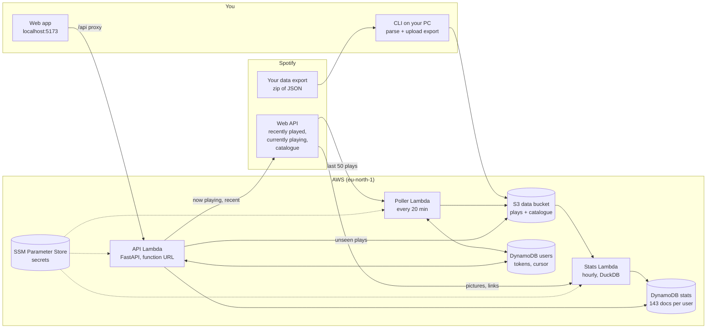

# Architecture

How the Spotify stats app works today (Stage 1), end to end. The reasons behind each choice
are in [decisions.md](decisions.md), how pictures are cached is in [caching.md](caching.md),
and the formal records are in [../adr](../adr).

## The big picture



There are two paths, and they only meet in storage:

- **Write path:** plays come in (the export once, the poller every 20 minutes) and land in
  S3. The stats Lambda turns them into finished answers in DynamoDB.
- **Read path:** the app asks the API, which reads one finished answer from DynamoDB. Nothing
  is calculated when the app opens.

That split is what lets later stages (Airflow and dbt, Iceberg, Kafka and Flink) replace parts
of the write path without touching the app.

## Components

| Piece | Code | Runs | Does |
|---|---|---|---|
| Export parser | `ingest/…/export.py`, `cli.py` | On your PC | Turns Spotify's export zip into clean `Listen` records (drops podcasts and broken rows, fingerprints each play) |
| Uploader | `jobs/…/cli.py upload-export` | On your PC | Converts listens to Parquet, tags them with your Spotify ID, uploads to S3 |
| **Poller Lambda** | `ingest/…/poller.py` | Every 20 min (EventBridge) | For each user: refresh their token, fetch plays newer than their cursor, store raw JSON and listens in S3, move the cursor |
| **Stats Lambda** | `jobs/…/job.py` | Hourly (EventBridge) | For each user with new plays: download their files, load them into DuckDB, run the stat queries for every window, add pictures, write the documents to DynamoDB, merge small poll files |
| Catalogue | `jobs/…/catalog.py` | Inside the stats Lambda | Looks each top track and artist up in Spotify once, ever, and caches pictures and links in S3 |
| **API Lambda** | `api/…/app.py` | On request (function URL) | Spotify login, session tokens, serves stat documents, live now playing and recently played |
| Web app | `web/` | On your PC (`npm run dev`) | React screens: Home, Top, Stats; talks to the API through a local proxy |
| Infra | `infra/bootstrap`, `infra/live` | `terraform apply` from your PC | Everything in AWS, as code |

## Storage

### S3: the source of truth for plays

```
spotify-stats-data-<account>/
  uploads/user=<id>/…                            export zips (deleted after 7 days)
  raw/source=api/user=<id>/date=<day>/<t>.json   Spotify's recently-played answers, untouched
  listens/user=<id>/source=export/export.parquet the export, cleaned (13 MB for 431k plays)
  listens/user=<id>/source=api/<t>.jsonl         plays from each poll (small files)
  listens/user=<id>/source=api/compacted.parquet poll files merged by the stats job
  catalog/spotify.json                           pictures and links, shared by all users
```

S3 holds every play ever, cheaply. Duplicates can exist in storage; they're removed whenever
the plays are read, using `listen_id` (ADR 0003).

### DynamoDB: small things looked up by key

| Table | Key | Holds |
|---|---|---|
| `spotify-stats-users` | `user_id` | Display name, Spotify access and refresh tokens, `cursor_ms` (newest stored play) |
| `spotify-stats-stats` | `user_id` + `stat_name` | One finished answer per item, such as `top_artists#4_weeks`, as JSON |

### SSM Parameter Store

`/spotify-stats/spotify_client_id`, `spotify_client_secret`, `session_secret` (encrypted) and
`spotify_redirect_uri`. Terraform creates placeholders; `scripts/put_secrets.py` fills them, so
real secrets never sit in Terraform state.

## The stats job in detail

1. **Find users with new plays.** It compares the list of files with what the last build saw
   (the `_build` item), and also rebuilds everyone once a day after London midnight, since
   "today" and "last 4 weeks" move without new plays.
2. **Load.** Download the user's files to `/tmp` and load them into an in-memory DuckDB table
   with one SQL statement (`read_parquet([...]) UNION ALL BY NAME read_json([...])`), keeping
   one row per `listen_id` (the export's row wins over the API's).
3. **Calculate.** 11 query functions, each run once per window by filling in `$start` and
   `$end`:

   | Window | Start | End |
   |---|---|---|
   | `today`, `this_week`, `this_month`, `this_year` | London midnight / Monday / 1st / 1 Jan | now |
   | `4_weeks`, `6_months`, `12_months` | now minus 28 / 182 / 365 days | now |
   | `all_time` | none | none |
   | `year_2020` … | 1 Jan | next 1 Jan |

   9 stats × 15 windows + streaks + one Wrapped per year = 143 documents for 7 years of history.
4. **Pictures.** Add `image` and `url` to top lists, on repeat and new to you, from the shared
   catalogue file; only items it hasn't seen are looked up on Spotify (at most 500 a run, #1s
   first, paused while Spotify says to wait). See [caching.md](caching.md).
5. **Write.** Overwrite each document in DynamoDB; merge the poll files into
   `compacted.parquet` and delete only the files that were merged.

The 11 functions: `totals`, `top` (artists, tracks, albums), `minutes_by` (hour, day, month),
`listening_clock`, `streaks` (gaps and islands), `skip_rate`, `most_skipped`, `discoveries`,
`on_repeat`, plus `wrapped` which reuses them for one year. Lists rank by **time played**, then
streams. A stream is a play of at least 30 seconds; a skip is a play under 30 seconds.

## How a screen gets its data

Opening Top on "4 weeks", for example:

1. The browser asks `/api/me/stats/top_tracks?window=4_weeks` with your session token.
2. The Vite dev server on your PC forwards it to the API Lambda.
3. The API checks the token's signature (that's you), does **one DynamoDB read** of
   (you, `top_tracks#4_weeks`), and returns the JSON as it is: 100 rows with minutes, streams,
   picture addresses and links.
4. React draws the first 10 rows; "Show top 100" reveals the rest, which are already loaded.
   Pictures load from Spotify's servers as they scroll into view.

Nothing is calculated and Spotify isn't called. Only now playing and recently played go to
Spotify live.

## The API

| Route | Does |
|---|---|
| `GET /health` | Liveness check |
| `GET /auth/login?redirect_uri=` | Starts Spotify login; only app addresses are allowed (`exp://`, `spotifystats://`, localhost) |
| `GET /auth/callback` | Spotify returns here; saves tokens, sends the browser back with a 30-day session token |
| `GET /me` | Who you are |
| `GET /me/overview?window=` | Totals and top 5s in one call |
| `GET /me/stats/{stat}?window=` | One stat document |
| `GET /me/now-playing` | Live from Spotify, cached 5 s per user |
| `GET /me/recent?limit=` | Live from Spotify; stores plays the poller hasn't yet |
| `GET /me/stats/concerts` | Your top artists with UK dates (built hourly from Ticketmaster) |
| `DELETE /me` | Deletes the account: user record, every stat document, every S3 file of plays |

Session tokens are HMAC-signed by the API (`sessions.py`), so no session table is needed.

## Freshness

| What | How fresh |
|---|---|
| Now playing | About 10 s (the app polls; the bar ticks every second between polls) |
| Recently played | Live when the app asks |
| Stats (including today) | Up to about 80 min: a play is stored within 20 min, stats rebuild hourly. Opening the app stores unseen plays straight away |

## Deploying

Code merged on GitHub is not live until it's deployed: the Lambdas run whatever zip was last
uploaded. `uv run python scripts/deploy.py` (or the steps it runs) builds Linux ARM packages,
plans, asks, applies, fills secrets and checks `/health`. CI only lints, tests and validates;
GitHub can't deploy because the AWS account blocks GitHub's OIDC login (ADR 0002).

## Cost

Everything sits inside free tiers or close to it: Lambda and EventBridge are free at this
volume; DynamoDB is provisioned within the free 25 read and write units; S3 holds about 15 MB.
A $1 budget alarm and the account's spend limit guard against surprises.
